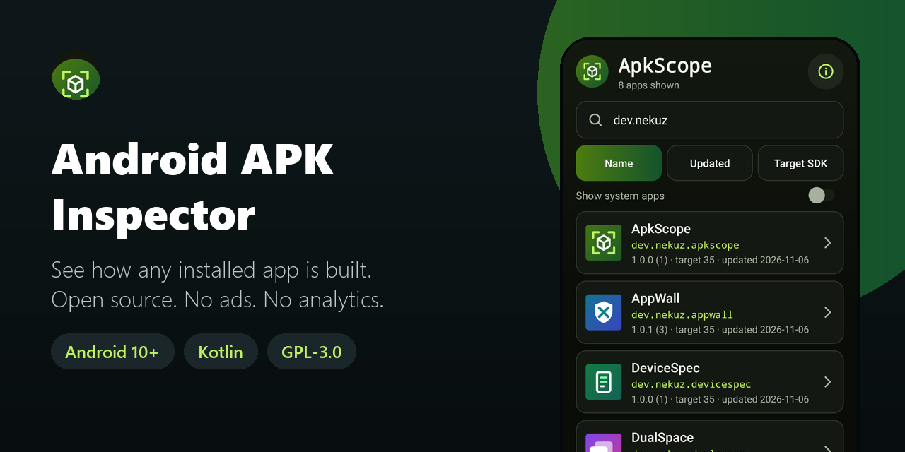
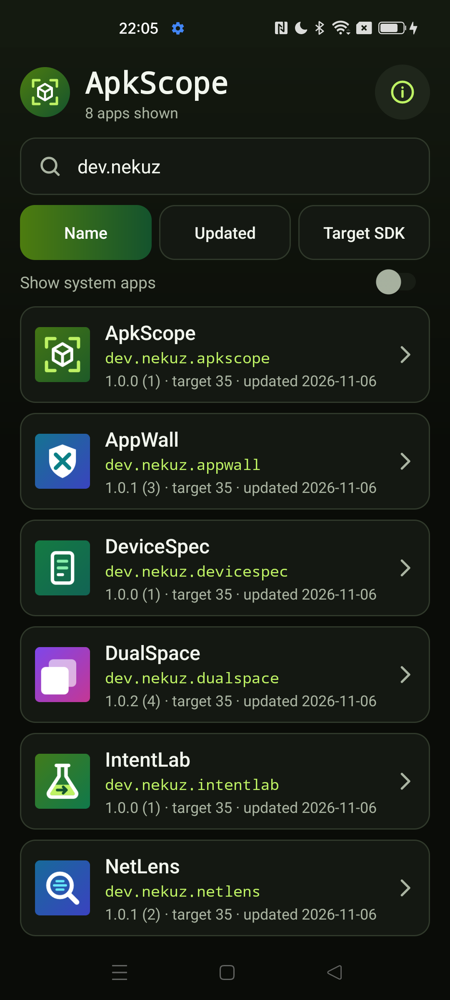
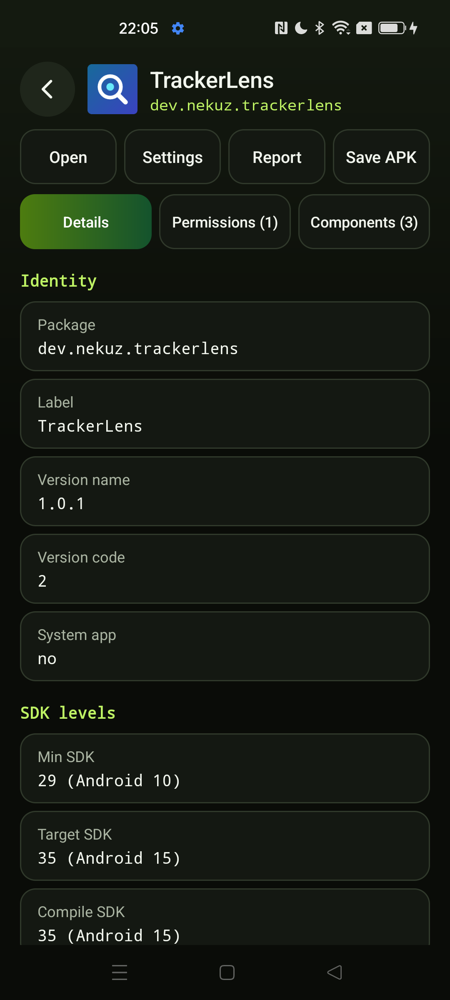
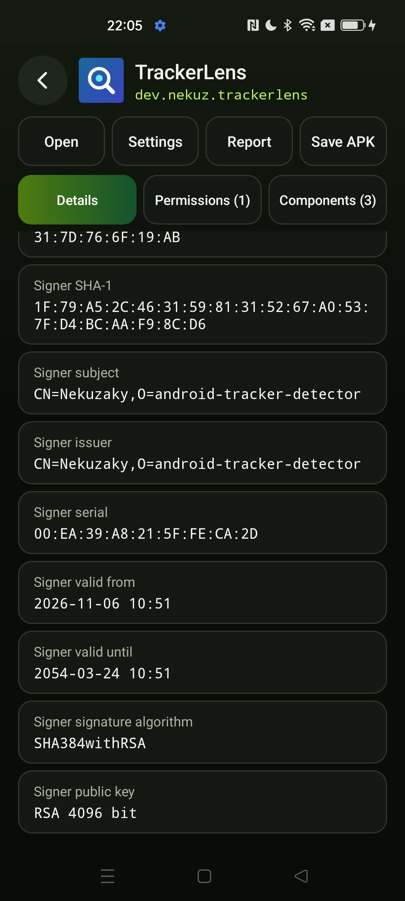
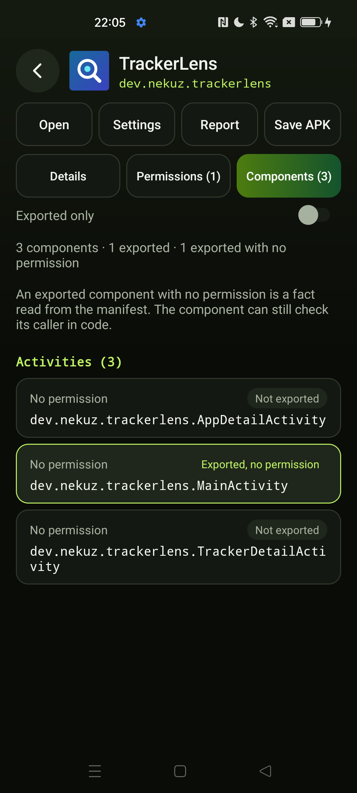

<div align="center">



# Android APK Inspector

**See how any installed Android app is built: versions, SDK levels, APK splits, native libraries, signing certificates, permissions and exported components. Works offline. Open source, no ads, no analytics.**

[](LICENSE)
[](#requirements)
[](https://kotlinlang.org)
[](app/build.gradle.kts)
[](app/src/main/AndroidManifest.xml)
[](https://github.com/Nekuzaky/android-apk-inspector/stargazers)

</div>

Android APK Inspector ships an app called **ApkScope**. It is a developer tool that shows what Android and the APK files of an app say about it, on the phone, with no account and no connection.

ApkScope has no Internet permission, so your list of apps and everything it reads stay on your phone unless you share or save them yourself.

## Screenshots

<p align="center">
  
  
  
  
</p>

## Features

- **App list:** search by name or package, sort by name, last update (newest first) or target SDK (lowest first), with a toggle for system apps
- **Identity:** package, label, version name and code, min, target and compile SDK
- **Install:** install and update time, installer package, UID, shared UID, data directory
- **APK files:** path and size of the base APK and every split, plus the total
- **Manifest flags:** `debuggable`, `allowBackup`, `usesCleartextTraffic`, `testOnly`
- **Native code:** ABIs and native library names, read from the zip directory of each APK
- **Signing:** SHA-256 and SHA-1 of each certificate, with subject, issuer, serial, validity, signature algorithm, public key and rotation history
- **Permissions:** every requested permission with its granted state
- **Components:** activities, services, receivers and providers, each marked exported or not with the permission protecting it, and a filter for exported only
- **Copy:** long press any value to copy it
- **Report:** a plain-text report through the share sheet, or saved as a file
- **Save APK:** save the base APK or any split where you choose, through the Android file picker
- **Open:** start the app or open its Android settings page
- No ads, no analytics, no account and no third-party libraries

## Exported components

A component that is exported with no permission is highlighted because a developer often wants to find it. This is a neutral fact read from the manifest, not a verdict. Many such components are normal, such as the launcher activity, and a component can still check its caller in code.

A provider counts as protected if it declares a read permission, a write permission or path permissions. The row shows which ones it has.

## Privacy and security

- No Internet permission, no analytics and no logging of app data.
- No storage permission and no `FileProvider`. Reports and APKs are saved only to a location you pick with `ACTION_CREATE_DOCUMENT`.
- Backups are off, and `dataExtractionRules` excludes everything from cloud backup and device transfer.
- Only the launcher activity is exported, and it reads nothing from its intent. The detail activity is not exported and checks the package name it receives.
- The action buttons ignore touches when another window covers them.

Other apps are treated as hostile input:

- **Labels and manifest text** have control, bidi, format and invisible characters removed and their length capped. A label with nothing visible falls back to the package name.
- **Package names** are always shown in full and are never shortened.
- **Icons** are drawn off the main thread into a fixed-size bitmap, with a fallback icon if drawing fails or the source image is too large.
- **Each app is read in its own guard**, so one broken app cannot break the list.
- **APK files are only read for their zip directory.** ApkScope parses the central directory itself, decompresses nothing, and writes nothing to disk. One app has a budget of 200,000 entries, 4,096 libraries and 8 seconds across all its APK files. When the budget runs out, the app shows a partial status.
- **Settings pages** are opened only through a system activity found by `MATCH_SYSTEM_ONLY`.

### Permissions

| Permission | Why it is needed |
| --- | --- |
| `QUERY_ALL_PACKAGES` | Android hides most installed apps from other apps without it. Inspecting any installed app is the whole purpose of ApkScope, so it needs the full list. It is used only to read package information on the phone, and with no Internet permission that information cannot be sent online by the app |

## Requirements

- Android 10 (API 29) or later
- JDK 21 and Android SDK 35 to build from source

Gradle 8.11 does not support the Java 25 runtime bundled with recent Android Studio versions, so use a separate JDK 21.

## Download

Download the signed APK from the [latest release](https://github.com/Nekuzaky/android-apk-inspector/releases/latest) and open it on your phone. Android may ask you to allow installs from the app you opened it with.

The release notes list the SHA-256 checksum of the APK and of its signing certificate.

## Build from source

A build signed with your own key cannot install over the release APK, so uninstall the app first.

```bash
git clone https://github.com/Nekuzaky/android-apk-inspector.git
```

```bash
cd android-apk-inspector
```

Create a `local.properties` file that points to your Android SDK:

```properties
sdk.dir=/path/to/Android/Sdk
```

Build a debug APK with JDK 21. No signing setup is needed:

```bash
JAVA_HOME=/path/to/jdk-21 ./gradlew assembleDebug
```

Run the unit tests:

```bash
JAVA_HOME=/path/to/jdk-21 ./gradlew testDebugUnitTest
```

Install it on a phone with USB debugging enabled:

```bash
adb install -r --user 0 app/build/outputs/apk/debug/app-debug.apk
```

### Signed release build

Create a signing key, then add a `keystore.properties` file at the project root. It is ignored by Git, so never commit it or your key:

```properties
storeFile=/path/to/your-key.jks
storePassword=your-password
keyAlias=release
keyPassword=your-password
```

```bash
JAVA_HOME=/path/to/jdk-21 ./gradlew assembleRelease
```

Without `keystore.properties` the build still works, and `assembleRelease` produces an unsigned APK.

## Limitations

- **The manifest as Android reports it.** Values come from `PackageManager`, not from parsing the APK. `usesCleartextTraffic` is the application flag, so a network security configuration can change the real behavior, and it is not read.
- **Compile SDK** is only available on Android 12 and later.
- **Native libraries** are names found under `lib/<abi>/` in the APK files. Libraries stored elsewhere, compressed in assets or downloaded later are not listed.
- **Component checks in code are invisible.** ApkScope reads declarations, and it does not run or call any component.
- **Very large apps.** The share sheet has a size limit, so a long report is shortened and says so. Use **Save as file** for the full text. If Android cannot return a whole manifest at once, ApkScope reads it in parts and says when something is missing.
- **Saving splits.** The file picker saves one file at a time, so a split app needs one save per file.
- **Saving in the background.** A copy runs while the app process is alive. If Android kills the process during a large copy, the partial file stays where you chose to save it.
- **A hanging icon.** Icons are drawn one at a time on a single thread. An icon that hangs instead of failing would leave the following rows on the fallback icon.
- **One profile at a time.** ApkScope only sees the current profile.
- **Not suited to the Play Store.** `QUERY_ALL_PACKAGES` is restricted, so the app is meant to be installed directly.

## Test status

Unit tests for the current source: 70 pass under `testDebugUnitTest`, on the JVM. They cover label cleaning, formatting, certificate formatting, sorting, filters, the report text and the zip reader limits, using crafted zip files.

Tested with a debug build on one phone: Oppo Reno4 Z 5G, Android 12, ColorOS.

| Check | Result |
| --- | --- |
| Version, SDK levels and UID of one app, compared with `dumpsys` | Same |
| SHA-256, SHA-1 and subject of one certificate, compared with `apksigner` | Same |
| Saved APK compared with the installed APK | Same MD5 |
| Permissions and exported state of one app, compared with `dumpsys` | Same |
| Report saved as a file and shared as text | Works |
| Open and Settings buttons | Works |
| Direct launch of the detail screen from ADB | Refused |
| List of 395 apps with system apps on, including a 6000x6000 icon and a long label with a bidi character | No crash. The memory settled near 65 MB, with a short peak after launch that was also present without the huge icon |
| Portrait and landscape screens read | No crash |
| Signed release build: install, app list, detail screen | Works, no crash |

Not tested: splits and native libraries compared with the APK files, a budget overrun on a phone, other brands, Android 10, 11, 13 and later, tablets, and work profiles. If something breaks on your phone, please open an issue.

## Related

- [Android App Firewall](https://github.com/Nekuzaky/android-app-firewall): cut Internet access per app.
- [Android Permission Manager](https://github.com/Nekuzaky/android-permission-manager): see what every app can access.
- [Android Tracker Detector](https://github.com/Nekuzaky/android-tracker-detector): find tracking code inside your apps.
- [Android Network Monitor](https://github.com/Nekuzaky/android-network-monitor): see the traffic of your apps.
- [Android App Duplicator](https://github.com/Nekuzaky/android-app-duplicator): run a second account of an app in a work profile.

## License

Distributed under the [GNU General Public License v3.0](LICENSE).
